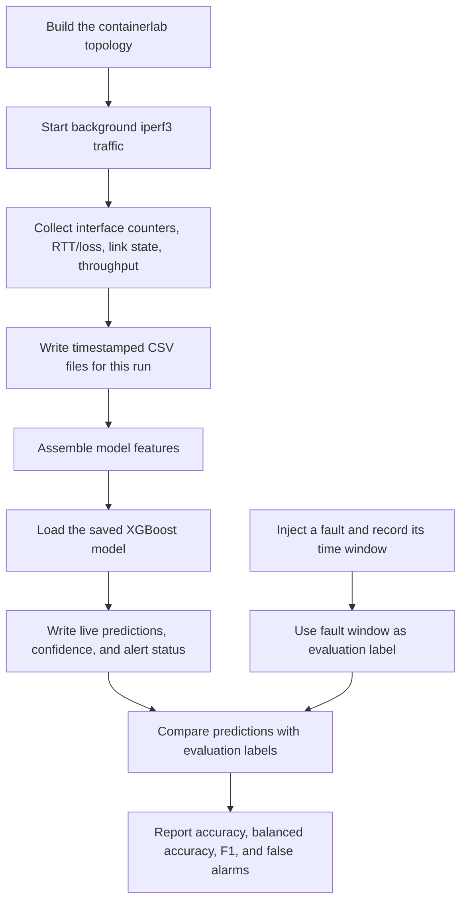
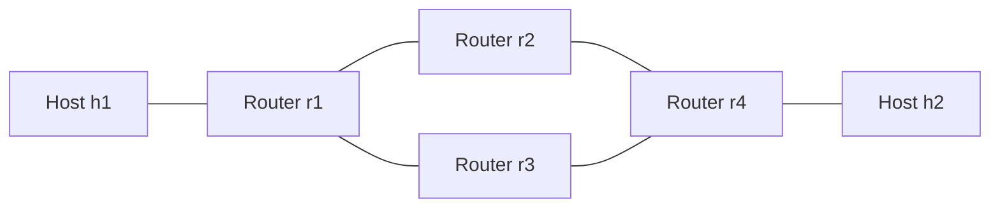

# Live Network Fault Detection — Project Manual

This guide explains the project from the network lab through live predictions,
evaluation, and the GitHub portfolio setup. It is written for someone who wants
to understand, run, explain, and extend the project—not only copy commands.

## 1. What the project does

The project creates a small routed network, measures its behavior, deliberately
injects network faults, and uses an XGBoost classifier to identify fault types
from telemetry.

The fault labels are **not given to the live detector**. The detector reads
measurements and predicts a class. A separate fault schedule records when
faults were injected so that the prediction can be scored afterward.

The result is a live lab prototype for detecting:

- Normal operation
- High latency
- Packet loss
- Congestion
- Link down

It is a demonstration and evaluation project, not a production network
monitoring service.

## 2. Project route map



The detector uses telemetry plus the saved model. The fault schedule is used
only to label and evaluate the results afterward.

### Network topology

The lab is a diamond: traffic from `h1` to `h2` can pass through either `r2` or
`r3`.



| Link | Interfaces |
|---|---|
| h1–r1 | `h1:eth1` ↔ `r1:eth1` |
| r1–r2 | `r1:eth2` ↔ `r2:eth1` |
| r1–r3 | `r1:eth3` ↔ `r3:eth1` |
| r2–r4 | `r2:eth2` ↔ `r4:eth2` |
| r3–r4 | `r3:eth2` ↔ `r4:eth3` |
| r4–h2 | `r4:eth1` ↔ `h2:eth1` |

## 3. How a live prediction is made

1. `collect_dataset.sh` verifies that all six lab containers are running and
   that `h1` can reach `h2`.
2. It starts a long-running `iperf3` flow so the lab has traffic to measure.
3. Four collectors append timestamped rows every five seconds: interface
   counters, interface state, RTT/loss, and throughput.
4. With `LIVE_DETECTOR=1`, `live_detector.py` polls the growing files every five
   seconds and scores new telemetry rows with the saved model.
5. The detector writes `predicted`, `confidence`, `alert`, and scoring time to
   `live_predictions.csv`, and prints predictions to `live_detector.log`.
6. The fault script records injection start/end times in `faults.csv`.
7. `evaluate_holdout_profile.py` later joins those time windows to telemetry
   and compares predictions with the known injected faults.

Features include packet/byte/error/drop counter rates and ratios, RTT,
measured ping loss, link state, throughput, and router/interface categories.
Auxiliary streams are aligned to telemetry using the nearest sample within
eight seconds. Missing auxiliary values receive explicit missing indicators.

There is one explicit domain rule: if the observed interface state is DOWN,
the detector returns `link_down` with 100% confidence. This uses measured
interface state, not `faults.csv` or the injection command.

## 4. Tools and what each one does

| Tool | Use in this project |
|---|---|
| Docker Desktop + Docker CLI | Runs the Linux containers and lets scripts execute commands inside them. |
| WSL 2 / Ubuntu | Linux shell used for Containerlab, collection scripts, Python, and Git. |
| Containerlab | Builds the six-node topology from `diamond.clab.yml`. |
| FRRouting (FRR) | Provides routing on routers `r1`–`r4`; configs are in `r1-frr.conf` through `r4-frr.conf`. |
| Linux `ip` tools | Read interface counters/state and bring a test link down/up. |
| Linux `tc` (`netem`, `tbf`) | Adds delay/loss and limits link throughput for controlled fault injection. |
| `ping` | Measures end-to-end RTT and estimates packet loss using five-packet bursts. |
| `iperf3` | Generates sustained traffic and supplies throughput observations. |
| Python | Runs training, feature assembly, streaming detection, and evaluation. |
| pandas / NumPy | Reads, aligns, cleans, and transforms timestamped telemetry. |
| scikit-learn | Group splitting, class weighting, and evaluation metrics. |
| XGBoost | Trains and serves the multi-class fault classifier. |
| Git | Tracks local source changes and commits. |
| GitHub / GitHub CLI (`gh`) | Stores the Git repository online, shares the portfolio, and supports collaboration. |

## 5. Important files and directories

| Path | Purpose |
|---|---|
| `diamond.clab.yml` | Defines hosts, routers, links, and the diamond topology. |
| `Dockerfile.hosts` | Builds the lab host image with `iperf3`. |
| `r1-frr.conf` … `r4-frr.conf` | FRR routing configuration for each router. |
| `collect_dataset.sh` | Preflight checks, starts collectors/traffic/detector, runs a fault sequence, and saves a unique run directory. |
| `telemetry_collect_enhanced_v2.sh` | Reads packet, byte, error, and drop counters from the kernel using `ip -s link`. |
| `link_state_collect_v2.sh` | Records interface operational state and carrier. |
| `rtt_collect_v3.sh` / generated burst collector | Collects RTT and ping-loss samples. |
| `inject_faults_enhanced_v2.sh` | Injects link-down, latency, packet-loss, and congestion faults, and writes `faults.csv`. |
| `live_detector.py` | Builds features from current telemetry and emits live class predictions/alerts. |
| `train_model_xgboost_runs.py` | Trains XGBoost from eligible measured runs and holds out complete runs. |
| `evaluate_holdout_profile.py` | Evaluates a profile excluded from training; can evaluate only one fault class. |
| `requirements.txt` | Pinned Python library versions used by the current environment. |
| `README.md` | Short GitHub landing page and quick start. |
| `GENERALIZATION_REPORT.md` | Full metrics, capture validity notes, and model limitations. |
| `dataset_runs/run_*` | Each separate capture: sensor CSVs, fault windows, and live predictions. |
| `model_runs/xgb_35run_20261013T082155Z/` | Current model, metrics, class list, and feature schema. |
| `model_runs/xgb_holdout_profile_*/` | Saved evaluation metrics and row-level predictions. |

Root-level CSVs and older training scripts preserve earlier experiments. The
current workflow uses per-run data under `dataset_runs/` and the `xgb_35run`
model by default.

## 6. Step-by-step: prepare and start the lab

Run these commands in the **Ubuntu WSL terminal**, from the project folder.
Keep Docker/containerlab commands in the same environment so they use the same
Docker engine and filesystem.

### Step 1: Check Docker connectivity

```bash
cd ~/aiops-project
docker context ls
docker ps
```

`docker context ls` shows which Docker daemon the CLI targets. `docker ps`
shows running containers. An empty `docker ps` means no containers are running
in that selected engine; it does not mean that fault detection has started.

For Docker Desktop on Windows, start Docker Desktop and enable the Ubuntu
distribution under **Settings → Resources → WSL Integration**. Then retry
`docker ps` inside Ubuntu. Avoid switching between the Windows named-pipe
context and the WSL Unix-socket context mid-run. See the official [Docker WSL
guide](https://docs.docker.com/desktop/features/wsl/).

### Step 2: Install project Python dependencies

```bash
cd ~/aiops-project
python3 -m venv .venv
source .venv/bin/activate
python -m pip install --upgrade pip
python -m pip install -r requirements.txt
```

The virtual environment stays local and is excluded by `.gitignore`.

### Step 3: Build the traffic-generator image

```bash
docker build -t aiops-multitool:latest -f Dockerfile.hosts .
```

`-f` selects the Dockerfile. `-t` gives the built image the name expected by
the topology. `iperf3` is installed into the image at build time so the lab
does not depend on downloading software after the test hosts are isolated.

### Step 4: Deploy the topology

```bash
sudo containerlab deploy -t diamond.clab.yml
docker ps --format 'table {{.Names}}\t{{.Status}}'
```

`-t` selects the topology file. Deployment should create `clab-aiops-diamond-h1`,
`h2`, and routers `r1`–`r4`.

### Step 5: Check reachability and traffic tools

```bash
docker exec clab-aiops-diamond-h1 ping -c 3 10.0.2.10
docker exec clab-aiops-diamond-h1 iperf3 --version
docker exec clab-aiops-diamond-h2 iperf3 --version
```

The collection script repeats important preflight checks itself. If `iperf3`
is missing, rebuild the host image and redeploy the topology.

## 7. Step-by-step: collect data and run the live detector

### Standard live collection

```bash
cd ~/aiops-project
LIVE_DETECTOR=1 PYTHON=./.venv/bin/python bash collect_dataset.sh 1
```

`1` means one complete run. `LIVE_DETECTOR=1` starts streaming predictions.
`PYTHON=...` selects the project virtual environment. `MODEL_DIR` defaults to
`model_runs/xgb_35run_20261013T082155Z/`.

The default run uses a 60-second pre-fault baseline, four 60-second faults with
30-second gaps, and a 60-second post-fault baseline: about eight minutes. The
detector and collectors run at the same time as the network
traffic and fault injection.

### Repeat the verified 500 ms profile

This order disables `r2-r4`, allowing the flow to use the `r3-r4` path for the
later latency and loss faults:

```bash
MODEL_DIR=model_runs/xgb_35run_20261013T082155Z \
LINK_DOWN_NODE=r2 LINK_DOWN_INTERFACE=eth2 LINK_DOWN_LOCATION=r2-r4 \
LATENCY_MS=500 PACKET_LOSS_PCT=18 CONGESTION_RATE=1mbit \
LIVE_DETECTOR=1 PYTHON=./.venv/bin/python bash collect_dataset.sh 1
```

### Repeat the two-run interpolation profile

These are the settings used for the two repeated, locked evaluations:

```bash
BASELINE_SECONDS=30 \
LATENCY_MS=450 PACKET_LOSS_PCT=15 CONGESTION_RATE=1500kbit \
LINK_DOWN_NODE=r2 LINK_DOWN_INTERFACE=eth2 LINK_DOWN_LOCATION=r2-r4 \
LIVE_DETECTOR=1 PYTHON=./.venv/bin/python bash collect_dataset.sh 1
```

The collection prints the new `dataset_runs/run_*` path. Preserve a run that
will be evaluated as a holdout before retraining. Add these metadata rows to
that run's `run_metadata.csv`:

```bash
printf 'training_eligible,false\nexclusion_reason,locked_holdout_do_not_train\n' \
  >> dataset_runs/<run_id>/run_metadata.csv
```

Replace `<run_id>` with the directory name printed by the collector. The
trainer skips runs marked `training_eligible,false`.

### What is written for every capture

- `telemetry.csv`: timestamped per-interface kernel counters.
- `rtt.csv`: five-ping RTT/loss measurements.
- `link_state.csv`: timestamped interface states.
- `throughput.csv`: throughput from the background `iperf3` stream.
- `faults.csv`: injected fault class, location, severity, and UTC interval.
- `live_predictions.csv`: streaming predictions, confidence, alert flag, and
  scoring timestamp (when live mode is enabled).
- `run_metadata.csv`: profile values, times, and training eligibility.
- `live_detector.log`, collector logs, and fault log: troubleshooting output;
  local runtime logs are excluded from Git.

## 8. Step-by-step: evaluate, train, and interpret

### Evaluate a locked holdout

```bash
./.venv/bin/python evaluate_holdout_profile.py dataset_runs/<run_id>
```

This evaluates all classes. To evaluate only one class, such as a held-out
link location where routing bypassed later faults:

```bash
./.venv/bin/python evaluate_holdout_profile.py \
  dataset_runs/<run_id> --fault-class link_down
```

The evaluator writes `holdout_predictions.csv` and `metrics.json` into a new
`model_runs/xgb_holdout_profile_*` directory. It reads `faults.csv` for labels;
the live detector does not.

### Train a new model (only after preserving holdouts)

```bash
./.venv/bin/python train_model_xgboost_runs.py
```

The trainer loads eligible measured run data, excludes runs marked
`training_eligible,false`, and groups rows by run. It uses a 20% run-level
holdout with `random_state=42`, so rows from one run cannot appear in both
training and test sets. It uses class-balanced sample weights and writes the
model, predictions, feature names, and metrics to a newly named
`model_runs/xgb_<N>run_<timestamp>/` directory.

Do not retrain on a locked evaluation run and then continue reporting its
score as an independent test. Once used for training, it is no longer a
holdout.

### Read the metrics correctly

- **Accuracy**: fraction of all rows classified correctly. Many normal rows
  can make this look high.
- **Balanced accuracy**: average recall across classes; better shows minority
  fault performance.
- **Macro F1**: average of per-class F1 with equal weight for each class.
- **Precision**: among predictions for a class, the fraction that was correct.
- **Recall**: among actual rows of a class, the fraction detected.
- **Normal false-alarm rate**: normal rows incorrectly flagged as faults.
- **Support**: number of labeled rows in that class. Small support means more
  run-to-run uncertainty.

For a portfolio, report accuracy alongside balanced accuracy, macro F1,
per-class results, and false-alarm rate. Do not claim that one accuracy number
means every fault is reliably detected.

## 9. Problems encountered and how they were addressed

| Problem | Why it mattered | Resolution / lesson |
|---|---|---|
| Docker showed an empty `docker ps` at the beginning. | The CLI could be pointed at an engine with no lab containers running. | Check `docker context ls`, start Docker Desktop, enable Ubuntu WSL integration, then deploy the topology. Later checks showed all six lab containers running. |
| Windows Docker and WSL Docker contexts looked different. | Windows uses a named pipe while WSL commonly uses `/var/run/docker.sock`; changing context can point commands at a different engine. | Run the project consistently from Ubuntu WSL and verify the engine with `docker ps` before deployment. |
| `iperf3` was missing in lab hosts. | Throughput telemetry could not be collected. | Add `iperf3` to `Dockerfile.hosts`, build `aiops-multitool:latest`, and redeploy. |
| Router CLI did not provide useful veth packet counters. | Counters from `vtysh` were incomplete for this lab. | Read kernel counters via `ip -s link` inside each router container. |
| Synthetic training data transferred poorly to the measured lab. | It did not resemble the real distribution of network signals. The synthetic-to-real test reached only 0.203 macro F1, a 45.2% normal false-alarm rate, and zero recall for high latency and packet loss. | Use measured Containerlab data for the main model. Keep the failed transfer result documented as a limitation. |
| A high score from a random row split overstated generalization. | Samples from one collection can be nearly identical and leak run conditions across splits. | Split by complete run using `GroupShuffleSplit`, and test separately on held-out profiles. |
| Link-down changed routing and bypassed later injections. | Later faults injected on `r3-r4` were labeled as active even though traffic had failed over to another path. | For clean all-class tests, disable `r2-r4` so `r3-r4` remains active. Mark invalid captures `training_eligible,false` and do not use them for training or all-class claims. |
| Ping-loss measurements were noisy. | Each sample contains only five pings; observed loss can differ from the injected percentage. | Report the observed signal and sample count; do not imply ping estimates exactly equal configured loss. Use additional repeats for stronger estimates. |
| Initial high accuracy did not mean every class was strong. | The 500 ms/18%/1 Mbit/s profile had weak packet-loss and congestion scores despite 0.929 accuracy. | Report per-class precision/recall/F1, compare repeated captures, and call this a prototype. |
| Containerlab generated a private CA key inside runtime state. | That key must never be placed in a public repository. | Add `/clab-aiops-diamond/` to `.gitignore`; it is ignored and not part of the staged GitHub snapshot. |

## 10. Results reached

### Main model split

The current model is `model_runs/xgb_35run_20261013T082155Z/`. It used 35
eligible measured runs: 28 train runs and seven held-out runs (5,080 test
rows).

| Metric | Result |
|---|---:|
| Accuracy | 0.991 |
| Balanced accuracy | 0.979 |
| Macro F1 | 0.973 |
| False-alarm rate on normal rows | 0.6% |

This split evaluates new runs from collected profiles. It does not prove
performance at every unseen severity or location.

### Untouched 500 ms profile

`dataset_runs/run_001_20261013T082217Z/` used 500 ms latency, 18% packet loss,
1 Mbit/s congestion, and link-down on `r2-r4`. Its all-class evaluation was
0.929 accuracy, 0.802 balanced accuracy, 0.771 macro F1, and 5.3% normal
false-alarm rate. Per-class F1: congestion 0.646, high latency 0.720,
link-down 1.000, normal 0.973, packet loss 0.516. Accuracy alone hides the
weakness in loss and congestion on this single profile.

### Repeated 450 ms profile

Two separate live collections used 450 ms latency, 15% packet loss, and
1.5 Mbit/s congestion. Pooled results:

| Evaluation | Rows | Accuracy | Balanced accuracy | Macro F1 |
|---|---:|---:|---:|---:|
| Offline evaluator | 1,061 | 0.972 | 0.927 | 0.919 |
| Live detector, timestamp-aligned to labels | 1,060 | 0.965 | 0.908 | 0.905 |

Pooled offline class F1: congestion 0.859, high latency 0.909, link-down
0.970, normal 0.988, packet loss 0.870. Packet-loss F1 varied from 0.778 on
the first run to 0.970 on the second, so more independent runs would improve
confidence in the estimate.

### Held-out link-down location

Moving link-down to the unused `r1-r3` segment gave 1.000 precision and 0.944
recall on the valid event (17 of 18 positive samples detected, no false
link-down alarms among other rows). Later fault events in that capture were
excluded because routing bypassed their injection path.

### Same-capture baseline comparison

On the first 450 ms held-out capture, the previous model scored 0.571 accuracy,
0.513 balanced accuracy, 0.400 macro F1, and a 43.6% normal false-alarm rate.
The current model reached 0.968 accuracy and 0.899 macro F1 on that capture:
39.7 percentage points higher accuracy, 49.9 points higher macro F1, and 42.0
points fewer normal false alarms.

Full per-class reports and individual run artifacts are in
`GENERALIZATION_REPORT.md` and `model_runs/xgb_holdout_profile_*/`.

## 11. Development roadmap: what changed over time

1. **Initial classifier experiments:** earlier scripts (`train_model.py`,
   `train_model_v2.py`, and enhanced variants) established labels and basic
   model training. Synthetic data was useful for a first experiment but did
   not transfer to measured network telemetry.
2. **Build a measurable lab:** the Containerlab diamond and FRR routers gave
   controlled paths where faults could be injected and observed.
3. **Replace synthetic-only evidence with measured runs:** collectors began
   saving counters, RTT/loss, link state, throughput, and the fault schedule
   into unique `dataset_runs/run_*` folders.
4. **Improve data validity and evaluation:** complete runs—not random rows—are
   held out during training. Captures where routing bypassed a later fault are
   marked ineligible. The clean link-down setting preserves the path for later
   latency/loss tests.
5. **Add streaming detection:** the live detector was wired into collection so
   it scores telemetry as it arrives while the same rows are saved for audit
   and offline scoring.
6. **Test beyond familiar conditions:** a 500 ms/18%/1 Mbit/s severity profile,
   a link-down on the unseen `r1-r3` segment, and two repeats at
   450 ms/15%/1.5 Mbit/s tested transfer beyond the training profiles.
7. **Document limits and make it shareable:** per-class metrics, noisy sensor
   estimates, valid/invalid captures, setup commands, pinned dependencies, and
   the generated-key exclusion were added to the reports and repository prep.

## 12. Common command reference

| Command | Meaning |
|---|---|
| `docker context ls` | List Docker engines/contexts and the currently selected one. |
| `docker ps` | List running containers in the selected engine. |
| `docker exec <container> <command>` | Run a command inside a running container. |
| `docker build -t aiops-multitool:latest -f Dockerfile.hosts .` | Build the lab host image with `iperf3`. |
| `sudo containerlab deploy -t diamond.clab.yml` | Create the six-node lab. |
| `python3 -m venv .venv` | Create a project-local Python environment. |
| `source .venv/bin/activate` | Activate that environment in the current shell. |
| `python -m pip install -r requirements.txt` | Install pinned Python dependencies. |
| `LIVE_DETECTOR=1 ... bash collect_dataset.sh 1` | Collect one run and start streaming detection. |
| `./.venv/bin/python evaluate_holdout_profile.py <run_dir>` | Score one held-out capture against injection labels. |
| `./.venv/bin/python train_model_xgboost_runs.py` | Train a new run-grouped model from eligible captures. |
| `docker exec clab-aiops-diamond-r2 tc qdisc show dev eth2` | Inspect whether shaping is present on the r2 link. |
| `sudo containerlab destroy -t diamond.clab.yml` | Stop and remove the topology when finished. |

The collection script installs an exit cleanup trap: it stops collectors and
iperf3, brings the configured link back up, and deletes test qdiscs from `r2`
and `r3`.

## 13. GitHub: present and maintain the project

Git records local snapshots; GitHub hosts the repository online. A repository
README is its landing page. GitHub can also track tasks with Issues, review
changes with pull requests, run automation, and showcase pinned projects on a
profile. Official starting points: [what GitHub is](https://docs.github.com/en/get-started/start-your-journey/what-is-github),
[adding an existing local project](https://docs.github.com/en/migrations/importing-source-code/using-the-command-line-to-import-source-code/adding-locally-hosted-code-to-github),
and [using a profile for a resume](https://docs.github.com/en/account-and-profile/tutorials/using-your-github-profile-to-enhance-your-resume).

### Current GitHub publishing state

- Local Git repository initialized on branch `main`.
- Project files staged for an initial commit; generated environment, runtime
  logs, Containerlab TLS state/private key, and copied per-run scripts with
  machine-specific paths are excluded.
- The Python environment is about 475 MB and is not part of the staged files.
- The project snapshot is about 46 MB before adding this manual.
- No GitHub remote or public repository has been created yet.
- The selected visibility is **Public**, but `gh auth status` reported that
  the local CLI is not signed in. Sign in before creating/pushing the repo.

### Continue the public upload

Authenticate in Ubuntu WSL:

```bash
cd ~/aiops-project
gh auth login
```

Choose GitHub.com, HTTPS, and browser sign-in. Keep your password and
one-time code private. Then verify:

```bash
gh auth status
git status
```

Before the first commit, configure the name/email that should appear on public
commits. Use your GitHub no-reply email if you do not want your personal email
visible:

```bash
git config --local user.name "Your Public Name"
git config --local user.email "YOUR_GITHUB_NOREPLY_EMAIL"
git diff --cached --stat
git commit -m "Publish live network fault detection prototype"
```

Then create and push the public repository with GitHub CLI:

```bash
gh repo create live-network-fault-detection \
  --public --source=. --remote=origin --push
```

Alternatively, create an **empty** public repository on GitHub named
`live-network-fault-detection`, then add its URL and push:

```bash
git remote add origin https://github.com/<YOUR_USERNAME>/live-network-fault-detection.git
git push -u origin main
```

Because this project already has a README and `.gitignore`, do not ask GitHub
to generate a second README or `.gitignore` when creating the empty remote.
After the push, check the rendered README and Mermaid diagram, confirm the
`model_runs/xgb_35run_...` files are present, and pin the repository to your
profile. GitHub supports Mermaid diagrams in Markdown files; see [Creating
diagrams](https://docs.github.com/en/get-started/writing-on-github/working-with-advanced-formatting/creating-diagrams).

### Everyday GitHub workflow

```bash
git status                         # See changed/untracked files
git add README.md                  # Select a file for the next snapshot
git diff --cached                  # Review staged changes
git commit -m "Explain the change" # Save a local snapshot
git push                           # Send committed changes to GitHub
git pull                           # Bring remote changes into this clone
```

Use a branch for a substantial change, push it, and open a pull request to
review it before merging. Use Issues for bugs or future tasks. These features
are useful even for a one-person portfolio because they leave a clear project
history.

## 14. What remains / limitations

- The project is complete as a live lab prototype. It is not production AIOps.
- The 450 ms profile has two captures; the 500 ms profile and held-out link
  location each have limited independent runs.
- Ping loss uses short five-packet samples and is noisy.
- Traffic routing can make an injected fault ineffective if it is applied to a
  path that failover has bypassed; validate signal and route before trusting
  labels.
- The model has known per-class variation. Always include class metrics and
  false-alarm rate with accuracy.
- GitHub publishing is not complete until the owner signs in, commits with
  their chosen public author identity, and pushes the repository.

