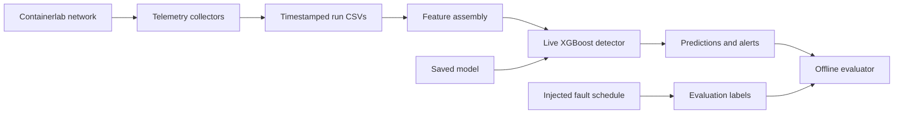

# Live Network Fault Detection Prototype

This repository contains a containerlab diamond network, telemetry and fault
collection scripts, run-isolated datasets, and XGBoost fault classifiers. The
current deliverable adds a streaming detector that consumes the same CSV
telemetry collected by the lab and appends timestamped predictions with
confidence and alert status.

This is a research/demo prototype. It includes live scoring, configurable
fault profiles, a clean grouped model evaluation, and held-out severity and
location experiments. The newest model scores well overall, but performance
still varies by fault type. See
[GENERALIZATION_REPORT.md](GENERALIZATION_REPORT.md) for evaluation details.

## Architecture



The detector reads telemetry and the saved model. The fault schedule supplies
labels for evaluation; it is not an input to live predictions.

## Demo requirements

- Linux or WSL with Python 3.14, Docker, and containerlab.
- The Python packages pinned in `requirements.txt`.
- `iperf3` in the lab hosts, as required by `collect_dataset.sh`.
- The saved clean model in `model_runs/xgb_35run_20261013T082155Z/`.

Create the Python environment and install the dependencies:

```bash
python3 -m venv .venv
source .venv/bin/activate
python -m pip install --upgrade pip
python -m pip install -r requirements.txt
```

Build the lab host image and deploy the diamond topology:

```bash
docker build -t aiops-multitool:latest -f Dockerfile.hosts .
sudo containerlab deploy -t diamond.clab.yml
```

Run one complete collection with live detection enabled:

```bash
LIVE_DETECTOR=1 PYTHON=./.venv/bin/python bash collect_dataset.sh 1
```

The collection lasts about eight minutes with the default one-minute
pre-fault and post-fault baselines. The detector prints status and writes
`live_predictions.csv` and `live_detector.log` inside the new
`dataset_runs/run_*` directory. It runs alongside the collectors and the
existing four-fault sequence. To choose another compatible trained model:

```bash
LIVE_DETECTOR=1 MODEL_DIR=model_runs/xgb_35run_20261013T082155Z \
  PYTHON=./.venv/bin/python bash collect_dataset.sh 1
```

For an offline replay of a completed run, score its available telemetry once:

```bash
./.venv/bin/python live_detector.py \
  --run-dir dataset_runs/run_029_20261012T215533Z --once
```

The live detector expects `telemetry.csv`, `rtt.csv`, `link_state.csv`, and
`throughput.csv` in the run directory. It rebuilds the training feature
schema, uses a nearest sample within eight seconds for the auxiliary streams,
and flags a non-normal prediction as an alert when its maximum class
probability is at least 0.60. Tune with `--alert-threshold` for a demo, and
report any changed threshold alongside results.

## Current reference results

The current model is
`model_runs/xgb_35run_20261013T082155Z/`. It uses 35 eligible measured runs;
the raw classifier on 28 train and seven held-out runs produced 0.991
accuracy, 0.979 balanced accuracy, 0.973 macro F1, and 0.6% normal false
alarms. These are run-held-out results, not a guarantee of performance on
every unseen severity.

The separate synthetic-to-real evaluation is under
`model_runs/xgb_synthetic_to_real_20261013T045709Z/`. It reports 0.203 macro
F1, a 45.2% normal false-alarm rate, and zero recall for high latency and
packet loss. Keep that result visible as a failed transfer experiment; do not
mix synthetic data into measured-lab performance claims.

The final untouched severity capture is
`dataset_runs/run_001_20261013T082217Z/` (500 ms latency, 18% packet loss,
1 Mbit/s congestion, and link-down on `r2-r4`). Its saved evaluation is
`model_runs/xgb_holdout_profile_run_001_20261013T082217Z_20261013T083012Z/`:
0.929 accuracy, 0.802 balanced accuracy, 0.771 macro F1, and 5.3% normal
false alarms. Per-class results and signal checks are in the report.
On this exact same capture, the previous `xgb_30run_20261013T043628Z`
model scored 0.497 accuracy, 0.381 macro F1, and 51.9% normal false alarms.
The new model therefore improves this profile’s accuracy by 43.2 percentage
points and macro F1 by 39.0 points.

A held-out-location capture at `dataset_runs/run_001_20261013T063041Z/` moves
link-down to `r1-r3`. Evaluated with the clean model on the valid link-down
event only, precision was 1.000 and recall was 0.944 (18 samples). Its later
latency/loss events were bypassed by routing and are excluded from all-class
claims and training.

## Additional held-out profile

The project also includes two locked repetitions of an interpolation profile
at 450 ms latency, 15% loss, and 1.5 Mbit/s congestion. Across 1,061 offline
rows the current model scored 0.972 accuracy and 0.919 macro F1; time-aligned
live predictions scored 0.965 accuracy and 0.905 macro F1 over 1,060 matched
rows. Run-to-run packet-loss F1 varied from 0.778 to 0.970, so this small
sample strengthens the evaluation but does not establish performance
stability. The full per-class report, signal checks, and same-capture baseline
comparison are in `GENERALIZATION_REPORT.md`.

## Main project files

- `collect_dataset.sh`: isolated telemetry/fault run collection; set
  `LIVE_DETECTOR=1` to attach the streaming prediction process.
- `live_detector.py`: feature assembly, scoring, alert printing, and CSV log.
- `train_model_xgboost_runs.py`: group split by run, model training, and saved
  evaluation artifact.
- `GENERALIZATION_REPORT.md`: metrics, fault-profile coverage, and honest
  limits on the unseen-location/severity claim.

To repeat the verified held-out profile, move link-down to `r2-r4` so the
`r3-r4` path remains active for later latency and loss events:

```bash
MODEL_DIR=model_runs/xgb_35run_20261013T082155Z \
LINK_DOWN_NODE=r2 LINK_DOWN_INTERFACE=eth2 LINK_DOWN_LOCATION=r2-r4 \
LATENCY_MS=500 PACKET_LOSS_PCT=18 CONGESTION_RATE=1mbit \
  LIVE_DETECTOR=1 PYTHON=./.venv/bin/python bash collect_dataset.sh 1
./.venv/bin/python evaluate_holdout_profile.py dataset_runs/<run_id>
```

To move the link-down fault to the unused `r1-r3` segment for a location test:

```bash
LINK_DOWN_NODE=r1 LINK_DOWN_INTERFACE=eth3 LINK_DOWN_LOCATION=r1-r3 \
  LIVE_DETECTOR=1 PYTHON=./.venv/bin/python bash collect_dataset.sh 1
./.venv/bin/python evaluate_holdout_profile.py dataset_runs/<run_id> --fault-class link_down
```

To retrain using all eligible measured runs (runs marked
`training_eligible,false` are excluded):

```bash
./.venv/bin/python train_model_xgboost_runs.py
```
